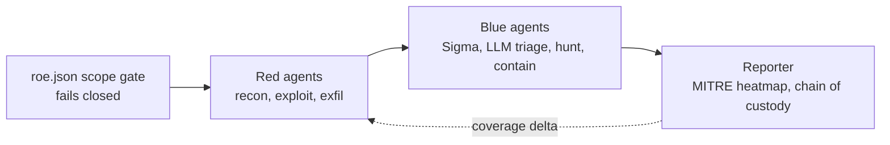

# Mohammad Ahmadi

**Security analyst · Detection engineering · Purple-team tooling**

Denver, CO · B.S. Cybersecurity, December 2026

---

I triage alerts in Microsoft Defender XDR, write KQL detections for privilege escalation, lateral movement and data exfiltration, and build open-source tooling that lets red and blue agents test each other.

## Projects

| Project | What it is | Stack |
|---|---|---|
| **[OpenElia](https://github.com/M3tan01/OpenElia)** | AI-assisted purple-team platform. Red, blue and reporter agents coordinate over the Model Context Protocol. | Python · MCP · Atomic Red Team · Docker |
| **[WireGuard-VPN-Server](https://github.com/M3tan01/WireGuard-VPN-Server)** | Step-by-step guide to a private VPN on a small cloud server, with firewall rules, SSH hardening and leak tests. | WireGuard · Ubuntu · UFW |

### How OpenElia works

- Offensive modules run in ephemeral, rootless Docker containers with all Linux capabilities dropped.
- Audit entries are chained with HMAC-SHA256, so tampering shows up in the log.
- Blue-team remediation stays in simulation mode until it is explicitly enabled.

## What I work with

| | |
|---|---|
| **Detection and response** | Microsoft Defender XDR · KQL · Sigma · Splunk · Wazuh · ELK |
| **Threat intelligence** | MITRE ATT&CK mapping · STIX/TAXII · MISP · OpenCTI |
| **AI security** | AI-assisted SOC workflows · LLM red teaming · OWASP Top 10 for LLM Applications |
| **Infrastructure** | AWS VPCs · Entra ID · Active Directory · Linux · Python · PowerShell |
| **Certifications** | CompTIA Security+ · CompTIA Network+ · Google Cybersecurity Specialization · NVIDIA Fundamentals of Deep Learning · Linux Command Line |
| **Languages** | Persian · English · Pashto |

## Experience

- **Junior Security Analyst**, Metropolitan State University of Denver · 2026 to present
- **Cybersecurity Analyst Intern**, Evolve Security Academy · 2026 to present
- **Junior Network Admin**, Metropolitan State University of Denver · 2025 to 2026, 20 sites and over 800 devices
- **Cyber Threat Intelligence Intern**, Western Union · 2025
- **IT Technician and Help Desk**, Metropolitan State University of Denver · 2022 to 2025

## Find me

- 🌐 Portfolio: [m3tan01.github.io](https://m3tan01.github.io)
- 💼 LinkedIn: [linkedin.com/in/mohammadma](https://www.linkedin.com/in/mohammadma/)
- 🎥 YouTube: [CyberArb](https://www.youtube.com/@CyberArb), step-by-step security tutorials on exploits and packet analysis
